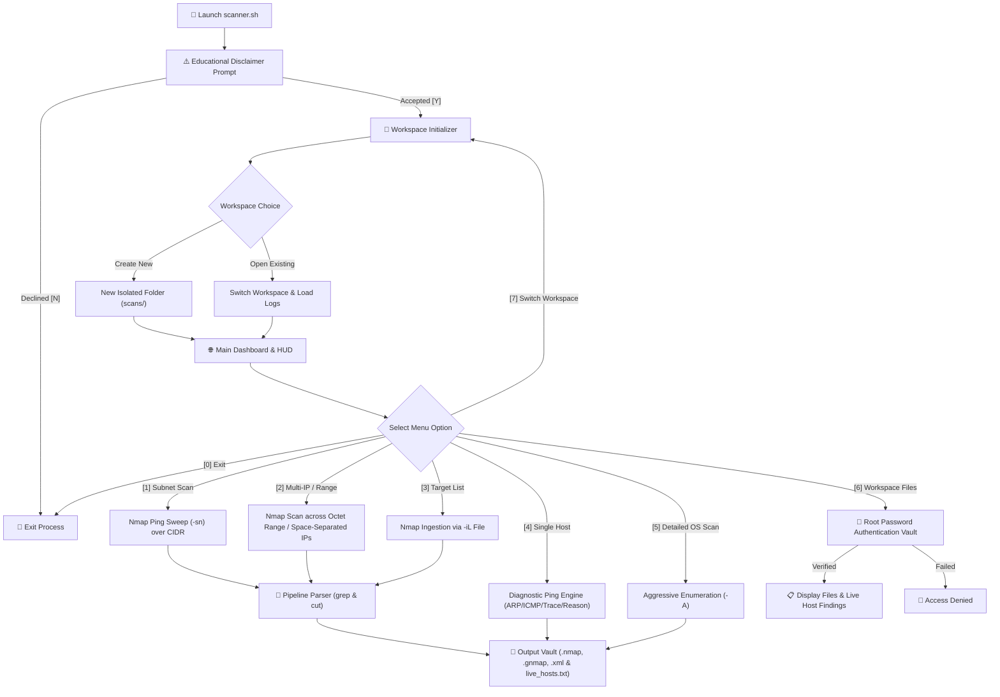

<div align="center">

# 🌐 Network-Scanner
### *Interactive Network Enumeration & Host Discovery Toolkit*

[](https://opensource.org/licenses/MIT)
[](https://www.linux.org/)
[](https://nmap.org/)
[](https://www.gnu.org/software/bash/)
[](https://www.hackthebox.com/)
[](https://github.com/aryxan)

```text
  _   _      _     ____                                  
 | \ | | ___| |_  / ___|  ___ __ _ _ __  _ __   ___ _ __ 
 |  \| |/ _ \ __| \___ \ / __/ _` | '_ \| '_ \ / _ \ '__|
 | |\  |  __/ |_   ___) | (_| (_| | | | | | | |  __/ |   
 |_| \_|\___|\__| |____/ \___\__,_|_| |_|_| |_|\___|_|   
       [ Network Enumeration & Host Discovery Toolkit ]
```

<p align="center">
  A fast, modular, and terminal-optimized network scanner engineered for cybersecurity students, penetration testers, and CTF players practicing on platforms such as <b>Hack The Box</b> and <b>TryHackMe</b>.
</p>

[Disclaimer](#-disclaimer) •
[Prerequisites](#-prerequisite-knowledge) •
[Architecture](#-architecture--workflow) •
[Features](#-key-features) •
[Pre-installed Tools](#-pre-installed-tools--dependencies) •
[Installation & Usage](#-installation--usage) •
[Directory Structure](#-directory-structure) •
[License](#-license)

</div>

---

## ⚠️ Disclaimer

> [!WARNING]  
> **FOR EDUCATIONAL AND AUTHORIZED SECURITY AUDITING PURPOSES ONLY.**  
> Scanning networks, endpoints, or infrastructure without explicit, prior mutual written permission from the owner is strictly illegal under applicable computer crime laws (e.g., the Computer Fraud and Abuse Act, UK Computer Misuse Act, etc.). The developer assumes no responsibility or liability for unauthorized activities or damages resulting from the use of this tool. Use strictly in owned labs, CTFs, or authorized penetration testing scopes.

---

## 🧠 Prerequisite Knowledge

To operate this toolkit effectively and accurately analyze the resulting telemetries, users should possess a foundational understanding of the following concepts:

### 1. Networking & Subnetting Architecture
- **IPv4 & CIDR Notation**: Understanding Classless Inter-Domain Routing (e.g., `10.129.2.0/24` designating 256 addresses from `.0` to `.255`), network addresses, and broadcast limits.
- **Routing & Gateways**: Understanding how traffic navigates from a local default gateway across routable subnets, and how virtual network adapters (e.g., `tun0`, `tun1`, `tap0` used by OpenVPN for CTFs) route packet traffic to secluded target clusters.

### 2. Protocol Telemetry (Layer 2 vs. Layer 3)
- **ARP (Address Resolution Protocol - Layer 2)**:
  - Inside a contiguous Ethernet subnet, Nmap defaults to sending raw ARP requests (`who-has <target> tell <attacker>`).
  - ARP discovery is fast, non-routable, and cannot be filtered by host-based software firewalls.
- **ICMP (Internet Control Message Protocol - Layer 3)**:
  - Routed discovery across subnets relies on ICMP Echo Requests (`Type 8 / Code 0`) and Echo Replies (`Type 0 / Code 0`).
  - Understanding **TTL (Time to Live)** values returned in ICMP replies provides preliminary operating system identification:
    - `TTL ≈ 64`: Linux / Android / macOS
    - `TTL ≈ 128`: Microsoft Windows
    - `TTL ≈ 255`: Cisco / Solaris / Network appliances
- **ARP vs. ICMP Diagnostic Nuances**:
  - Recognizing why Nmap might indicate a host is up via an ARP reply before an ICMP packet is ever dispatched, and knowing how to force ICMP probes across local boundaries with `--disable-arp-ping`.

### 3. Nmap Mechanics & Scanning Flags
- **`-sn` (No Port Scan)**: Disables default TCP/UDP port scans; restricts Nmap strictly to host discovery / ping sweeping.
- **`-PE` (ICMP Echo Ping)**: Forces the use of standard ICMP echo requests against targets.
- **`--packet-trace`**: Dumps real-time socket transactions showing exact sent (`SENT`) and received (`RCVD`) frames, protocol headers, and timestamps.
- **`--reason`**: Instructs Nmap to report the explicit kernel/packet condition that triggered its alive/open classification (e.g., `received arp-response`, `received echo-reply`).
- **`-A` (Aggressive Analysis)**: Executes a comprehensive multi-vector scan combining OS fingerprinting (`-O`), version enumeration (`-sV`), default NSE scripts (`-sC`), and traceroute (`--traceroute`).

### 4. Linux Security & Privilege Model
- **Raw Socket Privileges**: Generating custom ARP or ICMP frames requires raw network socket access, necessitating `sudo` (super-user) privileges.
- **Root Authentication**: Understanding cryptographic password validation against the Linux shadow file (`/etc/shadow`) or PAM (Pluggable Authentication Modules).

---

## 🏗️ Architecture & Workflow



---

## ✨ Key Features

- **🛡️ Mandatory Educational Guardrail**: Presents an explicit author attribution and legal warning on launch; requires unambiguous user consent before initiating network activity.
- **🗂️ Isolated Session Workspaces**: Keeps every engagement organized under dedicated subfolders (`./scans/<workspace>/`), automatically resolving naming conflicts (e.g., `lab_1`, `lab_1_1`) so data is never overwritten.
- **🔐 Root-Protected Finding Vault**: Viewing stored files and discovered credentials requires root authentication, securing sensitive pentest logs from unauthorized local users.
- **⚡ Automated Network Detection**: Autonomously inspects active routing tables and virtual adapters (`tun0`, `tun1`, `eth0`) to detect target subnets in CTF labs without manual configuration.
- **🎯 Smart Target Selection**: Allows picking targets by direct IP address or by selecting their index number from the discovered `live_hosts.txt` table.
- **🖥️ Pixel-Perfect Terminal Interface**: Features dynamic string-length calculation and ANSI escape code stripping to maintain 100% straight, non-breaking box borders across any terminal emulator.

---

## 📋 Scan Modes & Command Mapping

| Option | Operation | Underlying Command Pipeline | Output Artifacts |
| :---: | :--- | :--- | :--- |
| **`[1]`** | **Subnet Sweep** | `sudo nmap <CIDR> -sn -oA tnet \| grep for \| cut -d' ' -f5` | `tnet.*`, `live_hosts.txt` |
| **`[2]`** | **Multiple IPs / Range** | `sudo nmap -sn -oA tnet_multiple <TARGETS> \| grep for \| cut -d' ' -f5` | `tnet_multiple.*`, `live_hosts.txt` |
| **`[3]`** | **Target List File** | `sudo nmap -sn -oA tnet_list -iL <FILE> \| grep for \| cut -d' ' -f5` | `tnet_list.*`, `live_hosts.txt` |
| **`[4]`** | **Single Host Discovery** | `sudo nmap <IP> -sn -oA host_<IP>` *(Optional: `-PE`, `--packet-trace`, `--reason`, `--disable-arp-ping`)* | `host_<IP>.*` |
| **`[5]`** | **Detailed OS & Services** | `sudo nmap -A <IP> -oA os_details_<IP>` | `os_details_<IP>.*` |
| **`[6]`** | **Inspect Findings** | Validates root via `/etc/shadow`, `su`, or `sudo -S` before running `ls -lah` | File listings & logs |

---

## 🛠️ Pre-installed Tools & Dependencies

Ensure your Linux environment has the required packages installed:

| Dependency | Command | Role in Toolkit |
| :--- | :--- | :--- |
| **Nmap** | `nmap` | Core network exploration, ping scanning, and OS detection engine |
| **Bash** (v4.0+) | `bash` | CLI runtime, dynamic table padding, and menu loop control |
| **IPRoute2** | `ip` | Network interface detection and routing table inspection |
| **Coreutils** | `grep`, `cut`, `sort`, `sed`, `printf`, `cat`, `wc` | Output parsing, stream filtering, and live host extraction |
| **Python 3** | `python3` | High-fidelity shadow hash verification for root authentication |
| **Sudo** | `sudo` | Raw socket operations for privileged TCP/ARP/ICMP frame creation |

### One-Line Installation

**Debian / Ubuntu / Kali Linux / Parrot Security OS**:
```bash
sudo apt update && sudo apt install -y nmap iproute2 coreutils python3 sudo bash
```

**Arch Linux / BlackArch**:
```bash
sudo pacman -Syu --needed nmap iproute2 coreutils python sudo bash
```

**Fedora / RHEL / CentOS**:
```bash
sudo dnf install -y nmap iproute coreutils python3 sudo bash
```

---

## 💻 Installation & Usage

### 1. Clone the Repository
```bash
git clone https://github.com/aryxan/Network-Scanner.git
cd Network-Scanner
```

### 2. Grant Execution Permissions
```bash
chmod +x scanner.sh
```

### 3. Launch the Toolkit
```bash
./scanner.sh
```

---

## 🖥️ User Interface Preview

```text
┌──[ Session Overview ]────────────────────────────────────┐
│ Workspace     : lab_1                                    │
│ Directory     : ./scans/lab_1                            │
│ Local Network : 10.10.14.2/23                            │
│ Live Hosts    : 3 discovered                             │
├──────────────────────────────────────────────────────────┤
│ HOST DISCOVERY                                           │
│  [1] Scan Subnet / Network                               │
│  [2] Scan Multiple IPs / Range                           │
│  [3] Scan Targets from File                              │
│                                                          │
│ TARGET ENUMERATION                                       │
│  [4] Scan Single IP                                      │
│  [5] Detailed OS & Service Scan                          │
│                                                          │
│ WORKSPACE & CONTROLS                                     │
│  [6] View Workspace Files                                │
│  [7] Create or Switch Workspace                          │
│  [0] Exit                                                │
└──────────────────────────────────────────────────────────┘
```

---

## 📂 Directory Structure

```text
Network-Scanner/
├── .gitignore              # Ignores sensitive scan dumps and temporary artifacts
├── README.md               # Detailed project documentation and usage guide
├── scanner.sh              # Primary executable menu-driven script
└── scans/                  # Base directory for all scan workspaces (git-ignored)
    ├── htb_starting_point/
    │   ├── live_hosts.txt  # Extracted deduplicated IP list of responsive targets
    │   ├── tnet.nmap       # Human-readable Nmap scan logs
    │   ├── tnet.gnmap      # Grepable Nmap output format
    │   └── tnet.xml        # XML format for vulnerability parsers
    └── scan_20261018/
        ├── host_10_129_2_18.nmap
        └── os_details_10_129_2_18.nmap
```

---

## 🤝 Contributing

Contributions, bug reports, and suggestions are welcome!
1. Fork the Project.
2. Create your Feature Branch (`git checkout -b feature/NewScanMode`).
3. Commit your Changes (`git commit -m 'feat: Add UDP top ports scan'`).
4. Push to the Branch (`git push origin feature/NewScanMode`).
5. Open a Pull Request.

---

## 👤 Author

- **Aryan Gupta** — [@aryxan](https://github.com/aryxan)

---

## 📄 License

Distributed under the **MIT License**. See [`LICENSE`](https://opensource.org/licenses/MIT) for more information.
